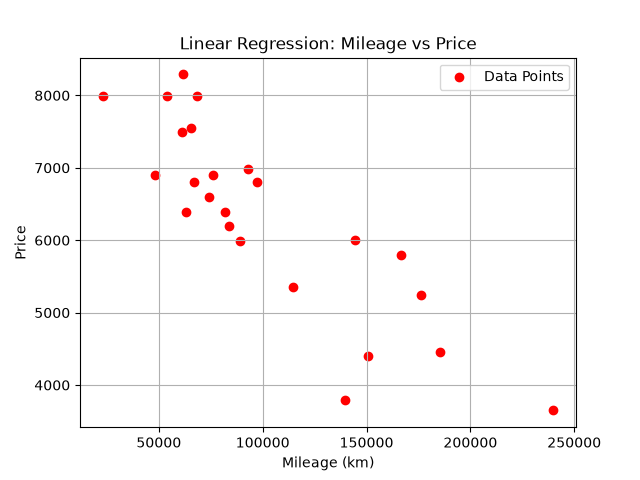
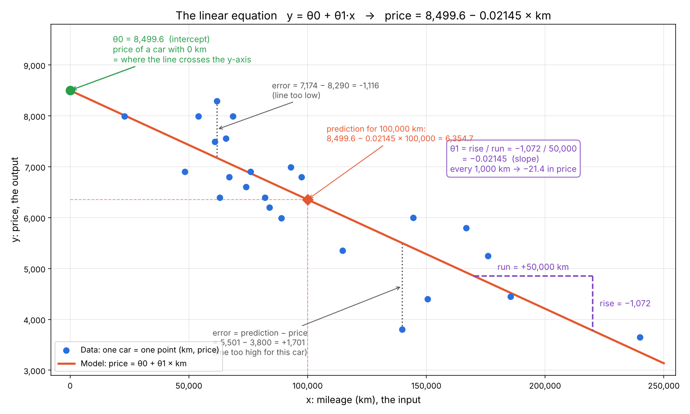
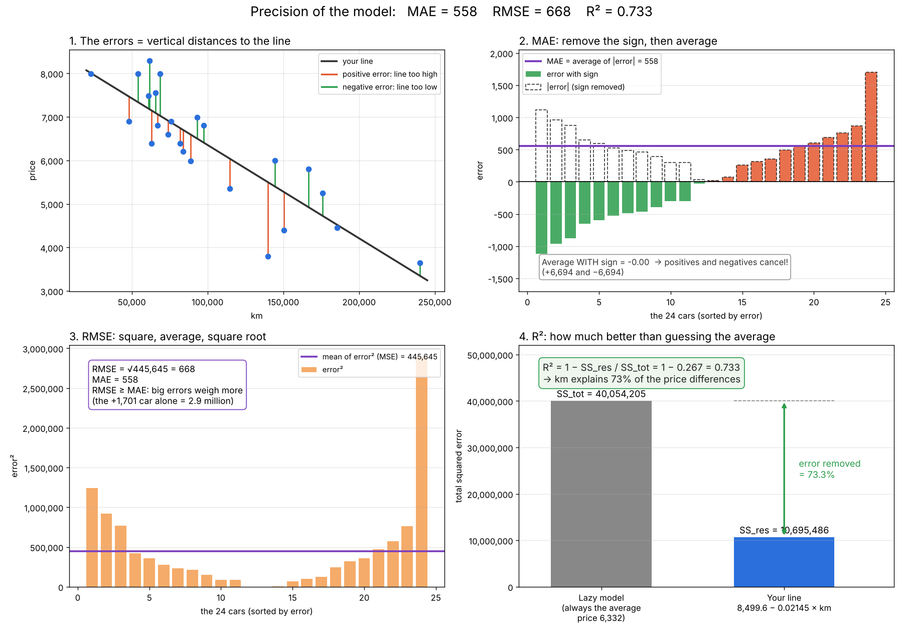

# ft_linear_regression

> An introduction to machine learning: predicting the price of a car from its mileage with a linear function trained by **gradient descent**, written from scratch (no `numpy.polyfit`, no scikit-learn).



---

## Table of contents

1. [Overview](#overview)
2. [Project structure](#project-structure)
3. [Installation](#installation)
4. [Usage](#usage)
5. [How it works](#how-it-works)
   - [The dataset](#1-the-dataset)
   - [The hypothesis](#2-the-hypothesis)
   - [The error](#3-the-error)
   - [The cost function](#4-the-cost-function)
   - [Gradient descent](#5-gradient-descent)
   - [Simultaneous update](#6-simultaneous-update)
   - [Normalization](#7-normalization)
   - [Converting the thetas back](#8-converting-the-thetas-back)
   - [Learning rate](#9-learning-rate)
   - [Number of iterations](#10-number-of-iterations)
6. [Results](#results)
7. [Bonus](#bonus)
   - [Plot](#plot)
   - [Precision](#precision)
8. [Mathematical proofs](#mathematical-proofs)
9. [Error handling](#error-handling)
10. [Resources](#resources)

---

## Overview

The goal of this project is to implement the simplest machine learning algorithm: a **linear regression with one feature**.

Two programs are required:

| Program | Role |
|---|---|
| `predict.py` | Asks for a mileage and prints the estimated price using `estimatePrice(mileage) = θ0 + θ1 × mileage`. Before training, `θ0 = 0` and `θ1 = 0`. |
| `train.py` | Reads `data.csv`, runs gradient descent, and saves `θ0` and `θ1` for `predict.py`. |

Bonus:

| Program | Role |
|---|---|
| `plot.py` | Plots the data and the regression line on the same graph. |
| `precision.py` | Computes the precision of the model (MAE, RMSE, R²). |

---

## Project structure

```
ft_linear_regression/
├── data.csv                 # dataset: 24 cars (km, price)
├── predict.py               # mandatory: predict a price from a mileage
├── train.py                 # mandatory: train the model with gradient descent
├── plot.py                  # bonus: data points + regression line
├── precision.py             # bonus: MAE, RMSE, R²
├── requirements.txt         # dependencies
├── regression_plot.png      # plot of the result
├── linear_equation.png      # annotated diagram of the linear equation
├── precision_metrics.png    # visual explanation of MAE, RMSE and R²
└── Thetas_case/
    └── thetas.json          # trained parameters (θ0, θ1)
```

---

## Installation

```bash
git clone <repo-url> ft_linear_regression
cd ft_linear_regression
python3 -m venv .venv
source .venv/bin/activate
pip install -r requirements.txt
```

Dependencies:

- `pydantic`: validation of the CSV rows and of the thetas
- `matplotlib`: plotting (bonus only)

No library is used for the math: the hypothesis, the gradient descent and the precision metrics are written by hand.

---

## Usage

### 1. Predict before training

```bash
python3 predict.py
```

```
'Thetas_case/thetas.json' not found, model not trained yet (theta0 = 0, theta1 = 0).
Enter mileage (km): 100000
Estimated price for 100000 km: 0.00
```

The model is not trained yet, so `θ0 = θ1 = 0` and every prediction is `0`, as required by the subject.

### 2. Train

```bash
python3 train.py
```

```
Training completed. Final parameters: Theta(theta0=8499.599649..., theta1=-0.021448963...)
```

### 3. Predict after training

```bash
python3 predict.py
```

```
Enter mileage (km): 100000
Estimated price for 100000 km: 6354.70
```

### 4. Bonus

```bash
python3 plot.py        # opens the graph
python3 precision.py   # prints MAE, RMSE, R²
```

---

## How it works

### 1. The dataset

`data.csv` contains **m = 24** cars. Each row is one *training example* `(km, price)`:

```
km,price
240000,3650
139800,3800
...
61789,8290
```

| | Min | Max |
|---|---|---|
| km | 22,899 | 240,000 |
| price | 3,650 | 8,290 |

**m** is simply the number of rows (cars), without the header. It is computed from the data, never hard-coded.

### 2. The hypothesis

The model is a straight line:

```
estimatePrice(km) = θ0 + θ1 × km
```

- **θ0** (intercept): the price predicted for a car with 0 km.
- **θ1** (slope): how much the price changes per km. It is negative: more km means a cheaper car.

Training means finding the two numbers θ0 and θ1 that make the line fit the 24 cars as well as possible.



#### Reading the equation `y = θ0 + θ1 · x`

This is the equation of a straight line, the same one as `y = a·x + b` in algebra:

| Symbol | In algebra | In this project | Value |
|---|---|---|---|
| `x` | input (horizontal axis) | mileage (km) | given by the user |
| `y` | output (vertical axis) | price | what we predict |
| `θ0` | intercept `b` | price at 0 km | **8,499.6** |
| `θ1` | slope `a` | change in price per km | **−0.02145** |

**θ0, the intercept (green point).** Set `x = 0`: `y = θ0 + θ1 × 0 = θ0`. So θ0 is where the line crosses the vertical axis: the price predicted for a car with 0 km, about 8,500.

**θ1, the slope (purple triangle).** The slope is `rise / run`: how much `y` changes when `x` increases. Between 170,000 km and 220,000 km the line drops by 1,072, so `θ1 = −1,072 / 50,000 = −0.02145`. Every 1,000 km costs about 21.4 in value. The slope is **negative**, so the line goes **down**: the more a car has been driven, the cheaper it is.

**A prediction (red diamond).** To estimate a price, read the line above the mileage:
`8,499.6 − 0.02145 × 100,000 = 6,354.7`.

**The errors (dotted lines).** The vertical distance between a car and the line is its error, `prediction − price`:
- the car at 139,800 km sold for 3,800, the line says 5,501: error **+1,701** (line too high),
- the car at 61,789 km sold for 8,290, the line says 7,174: error **−1,116** (line too low).

Training chooses θ0 and θ1 so that these vertical distances are as small as possible overall (smallest sum of squared errors).

### 3. The error

For each car `i`:

```
error[i] = estimatePrice(km[i]) − price[i]
```

| Error | Meaning | What the line must do |
|---|---|---|
| positive | the line predicts **too high** | go down |
| negative | the line predicts **too low** | go up |
| zero | perfect for this car | nothing |

The error is the feedback that makes learning possible: its **sign** gives the direction, its **size** gives how far to move.

### 4. The cost function

To measure how bad a whole line is, the errors are squared (so positive and negative errors do not cancel) and averaged:

```
J(θ0, θ1) = (1 / 2m) × Σ error[i]²
```

- **squared**: every error counts positively, and big errors count more
- **1/m**: an average, so the size of the dataset does not change the scale
- **½**: cancels the 2 that appears when differentiating

The best line is the one with the **smallest cost**. For linear regression this cost has a single global minimum (a "bowl"), so gradient descent always reaches the same answer.

### 5. Gradient descent

Gradient descent starts from `θ0 = θ1 = 0` and repeatedly takes a small step **downhill** on the cost:

```
θj := θj − learningRate × ∂J/∂θj
```

The partial derivatives of the cost (see [proofs](#mathematical-proofs)) are:

```
∂J/∂θ0 = (1/m) × Σ error[i]
∂J/∂θ1 = (1/m) × Σ error[i] × km[i]
```

Multiplying by the learning rate gives exactly the formulas of the subject:

```
tmpθ0 = learningRate × (1/m) × Σ (estimatePrice(mileage[i]) − price[i])
tmpθ1 = learningRate × (1/m) × Σ (estimatePrice(mileage[i]) − price[i]) × mileage[i]

θ0 = θ0 − tmpθ0
θ1 = θ1 − tmpθ1
```

- `tmpθ0` is driven by the **average error**: it moves the whole line up or down.
- `tmpθ1` is driven by the **average of error × km**: it tilts the line. Cars with a high mileage weigh more, because changing θ1 moves their prediction more.

One iteration:

1. For every car, compute the prediction and the error with the **current** θ0, θ1.
2. Sum the errors and the errors × km.
3. Compute `tmpθ0` and `tmpθ1`.
4. Update θ0 and θ1.

### 6. Simultaneous update

Both corrections must be computed from the **same** (old) θ0 and θ1, then applied together:

```
✅ correct                         ❌ wrong
tmpθ0 = lr × ∂J/∂θ0(θ0, θ1)       θ0 = θ0 − lr × ∂J/∂θ0(θ0, θ1)
tmpθ1 = lr × ∂J/∂θ1(θ0, θ1)       θ1 = θ1 − lr × ∂J/∂θ1(new θ0, θ1)
θ0 = θ0 − tmpθ0
θ1 = θ1 − tmpθ1
```

That is why the temporary variables `tmpθ0` and `tmpθ1` exist: the gradient is a pair of slopes measured at **one** point.

### 7. Normalization

#### The problem

Mileages are huge (up to 240,000) compared to 1. Since the θ1 gradient is multiplied by km, it is about **100,000× bigger** than the θ0 gradient. With a single learning rate:

| Learning rate | What happens on the raw data |
|---|---|
| 0.5 | θ1 jumps to 291,500,000 at step 1, then −1.9 × 10¹⁸: **explodes** |
| 0.0000000001 | stable, but θ0 is still 0.0176 after 100,000 steps: **frozen** |

The cost surface is a very narrow ravine: extremely steep along θ1, almost flat along θ0. No learning rate works for both directions.

#### The fix

Every mileage is rescaled to the interval [0, 1] before training:

```
x = (km − min) / (max − min)
```

With this dataset: `min = 22,899`, `max = 240,000`, `max − min = 217,101`.

| km | x |
|---|---|
| 22,899 (min) | 0.000 |
| 61,789 | 0.179 |
| 139,800 | 0.538 |
| 240,000 (max) | 1.000 |

The car with the fewest km gets 0, the one with the most gets 1, and the order and spacing of the cars are kept. Both gradients now have the same scale, the cost becomes a round bowl, and a learning rate of 0.5 converges in a few hundred iterations.

Normalization **does not change the best line**: it only changes the units in which it is found.

### 8. Converting the thetas back

Training on `x` gives θ0' and θ1', valid for normalized mileages. `predict.py` receives real kilometers, so the thetas are converted back before saving. Substituting `x`:

```
price = θ0' + θ1' × (km − min) / (max − min)
      = [θ0' − θ1' × min / (max − min)] + [θ1' / (max − min)] × km
```

So:

```
θ1 = θ1' / (max − min)
θ0 = θ0' − θ1 × min
```

| | Normalized | Real km |
|---|---|---|
| θ0 | 8,008.43 | **8,499.60** |
| θ1 | −4,656.57 | **−0.021449** |

### 9. Learning rate

The learning rate is not computed from the data: it is a **hyperparameter**, chosen by testing and watching the cost.

| lr | Behaviour | Iterations to converge |
|---|---|---|
| 0.001 | very slow | 187,975 |
| 0.01 | slow | 21,114 |
| 0.1 | good | 2,340 |
| **0.5** | **good (chosen)** | **497** |
| 1.0 | fastest | 253 |
| 1.7 | oscillates, still converges | 205 |
| 1.8 | cost increases: **diverges** | — |

The theoretical limit is `lr < 2 / λmax`, where λmax is the largest eigenvalue of the cost's Hessian. For the normalized data λmax ≈ 1.136, so `lr < 1.76`, which matches the experiment. `0.5` is fast and safely below this limit.

### 10. Number of iterations

The cost never reaches 0 (the cars are not exactly on a line), so the loop cannot wait for a zero error. With `lr = 0.5`, the cost stops improving after about 500 iterations. Training runs a fixed number of iterations that is larger than needed; after convergence, the corrections are ≈ 0 and the extra iterations change nothing.

How the cost decreases:

| Iteration | Cost | tmpθ0 | tmpθ1 | θ0 (normalized) | θ1 (normalized) |
|---|---|---|---|---|---|
| 1 | 20,880,519 | −3,165.9 | −1,008.5 | 0 | 0 |
| 2 | 5,055,917 | −1,401.4 | −344.8 | 3,165.9 | 1,008.5 |
| 3 | 2,057,333 | −638.6 | −60.4 | 4,567.3 | 1,353.3 |
| 10 | 1,039,444 | −52.1 | 132.5 | 5,973.5 | 706.1 |
| 100 | 231,677 | −5.3 | 13.9 | 7,796.8 | −4,098.1 |
| ~500 | 222,823 | ≈ 0 | ≈ 0 | 8,008.4 | −4,656.6 |

---

## Results

```
θ0 = 8499.599649...
θ1 = -0.021448963...
```

```
price = 8499.6 − 0.021449 × km
```

- A car with 0 km would be worth about **8,500**.
- Each 1,000 km reduces the value by about **21**.

| Mileage | Estimated price |
|---|---|
| 0 km | 8,499.60 |
| 50,000 km | 7,427.15 |
| 100,000 km | 6,354.70 |
| 150,000 km | 5,282.26 |
| 200,000 km | 4,209.81 |

At the best line, the 24 errors balance exactly: 12 cars are above the line and 12 below, summing to +6,694 and −6,694. The average error is 0, which is exactly the condition `∂J/∂θ0 = 0`.

---

## Bonus

### Plot

`plot.py` draws:

1. every car as a point `(km, price)` (x-axis = mileage, y-axis = price),
2. the trained line `price = θ0 + θ1 × km` on the same graph.

The points go down from left to right, and the line passes through the middle of the cloud, which visually confirms that training worked.

### Precision

`precision.py` compares the predictions with the real prices. For each car, `error = prediction − price`, then three metrics are computed by hand.



#### MAE: Mean Absolute Error

```
MAE = (1/m) × Σ |error[i]|
```

The average size of a mistake, ignoring the sign. **MAE ≈ 557.84**: predictions miss the real price by about 558 on average.

#### RMSE: Root Mean Squared Error

```
RMSE = √( (1/m) × Σ error[i]² )
```

Square, average, square root (to come back to price units). Large mistakes weigh more, so RMSE ≥ MAE. **RMSE ≈ 667.57**.

#### R²: coefficient of determination

R² compares the model with the best model that ignores mileage: always predicting the **average price** (6,331.83).

```
SS_tot = Σ (price[i] − mean_price)²       = 40,054,205   (error of the "average" model)
SS_res = Σ error[i]²                      = 10,695,486   (error of our line)

R² = 1 − SS_res / SS_tot                  = 0.733
```

**Mileage explains 73.3% of the variation in car prices.** The remaining 27% comes from information that is not in the dataset (brand, condition, year…).

| R² | Meaning |
|---|---|
| 1 | perfect: every car on the line |
| **0.733** | **this model** |
| 0 | no better than predicting the average |
| < 0 | worse than the average: a bug |

For a simple linear regression, R² = r², where r is the correlation between km and price (r ≈ −0.856).

#### Expected output

| Metric | Value |
|---|---|
| MAE | 557.84 |
| RMSE | 667.57 |
| R² | 0.7330 |

---

## Mathematical proofs

### Deriving the gradients

Let `eᵢ = θ0 + θ1·xᵢ − yᵢ` and `J = (1/2m) Σ eᵢ²`.

Chain rule: `∂(eᵢ²)/∂θj = 2·eᵢ·∂eᵢ/∂θj`, with

| | ∂eᵢ/∂θ0 | ∂eᵢ/∂θ1 |
|---|---|---|
| θ0 | 1 | 0 |
| θ1·xᵢ | 0 | xᵢ |
| −yᵢ | 0 | 0 |
| **total** | **1** | **xᵢ** |

So:

```
∂J/∂θ0 = (1/2m) Σ 2·eᵢ·1  = (1/m) Σ eᵢ
∂J/∂θ1 = (1/2m) Σ 2·eᵢ·xᵢ = (1/m) Σ eᵢ·xᵢ
```

### Why each step lowers the cost

For a small step `Δθj = −lr·gj` (with `gj = ∂J/∂θj`):

```
ΔJ ≈ g0·Δθ0 + g1·Δθ1 = −lr·(g0² + g1²) < 0
```

The cost decreases until both gradients are 0: the bottom of the bowl.

### Why the learning rate has a limit

On a 1-D quadratic `f(θ) = (c/2)(θ − θ*)²`, one step gives:

```
θ_new − θ* = (1 − lr·c)(θ − θ*)
```

The distance to the minimum is multiplied by `(1 − lr·c)` at each step, so gradient descent converges if and only if `|1 − lr·c| < 1`, that is `0 < lr < 2/c`.

### Where the normalization formula comes from

We want a straight-line map `x = a·km + b` with `x(min) = 0` and `x(max) = 1`:

```
a·min + b = 0
a·max + b = 1
⇒ a = 1/(max − min),  b = −min/(max − min)
⇒ x = (km − min)/(max − min)
```

Since `min ≤ km ≤ max`, we get `0 ≤ x ≤ 1`, and `a > 0` keeps the order of the cars.

---

## Error handling

| Case | Behaviour |
|---|---|
| `thetas.json` missing | `predict.py` uses θ0 = θ1 = 0 |
| `thetas.json` invalid (not JSON, missing key, non-finite value) | clear error message, exit |
| Non-integer or negative mileage typed | asks again |
| `Ctrl+D` / `Ctrl+C` in `predict.py` | exits cleanly |
| `data.csv` missing, empty or invalid row | clear error message, exit |
| Negative km or price in the dataset | error, exit |
| All cars with the same mileage (`max − min = 0`) | error, exit (normalization impossible) |
| Mileage outside the data range | warning when the predicted price is negative |

---

## Resources

- [CS229 Lecture Notes: Andrew Ng (Stanford)](https://web.iitd.ac.in/~sumeet/cs229-notes1.pdf): linear regression, LMS rule, gradient descent
- [Linear regression: Gradient descent (Google ML Crash Course)](https://developers.google.com/machine-learning/crash-course/linear-regression/gradient-descent)
- [Gradient Descent Derivation (Chris McCormick)](https://mccormickml.com/2014/03/04/gradient-descent-derivation/)
- [Proof: the sum of residuals is zero in simple linear regression](https://statproofbook.github.io/P/slr-ressum)
- [The Method of Least Squares (JMP)](https://www.jmp.com/en/statistics-knowledge-portal/what-is-regression/the-method-of-least-squares)
